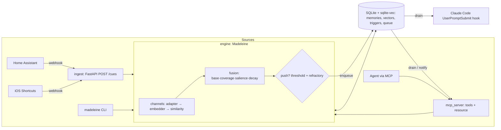

# Architecture (v0)

The contract is `src/madeleine/core/types.py`; the reasoning is in
[ADR 0001](docs/adr/0001-core-model.md) and [ADR 0002](docs/adr/0002-dependencies-and-sdk.md).
This document fixes the **module layout, ownership, and the seams between components** so
that workstreams can be built in parallel.



## Module layout and ownership

| Path | Owner (Phase 1 workstream) | Purpose |
|---|---|---|
| `core/types.py` | lead | Contract. Changes need an ADR. |
| `config.py` | lead | `load_config(env, **overrides)`, `resolve_db_path()` |
| `core/geohash.py` | lead | Pure geohash `encode/decode/bounds/is_valid`, `haversine_km` (use it; don't re-implement) |
| `core/serde.py` | lead | `parse_timestamp`, `context_from_fields`, `signal_from_json(s)`: the ONE way MCP/HTTP/CLI/webhooks parse inputs |
| `testing.py` | lead | `FakeClock`, `FakeEngine` (crude in-memory `MemoryEngine` for testing consumers), `FakeQueue` |
| `cli.py`, `demo.py`, `serve.py` | lead (integration) | Typer CLI and composition |
| `core/fusion.py` | core-engine | Pure functions: `fuse()`, `decay_factor()`, `salience_factor()`, `coverage()` |
| `engine.py` | core-engine | `Madeleine` (implements `MemoryEngine`), `create_engine()` |
| `store/sqlite.py` | core-engine | `SQLiteMemoryStore`, `SQLiteRecollectionQueue` (same file) |
| `store/memory.py` | core-engine | `InMemoryStore`, `InMemoryRecollectionQueue` (tests, ephemeral) |
| `channels/registry.py` | channels | `DefaultChannelRegistry`, `default_registry(config)` |
| `channels/{text,image,audio,time,geo,biometric,smell}.py` | channels | One module per sense |
| `channels/hashing.py` | channels | `HashEmbedder` (offline fake) |
| `channels/similarity.py` | channels | `cosine01`, helpers |
| `mcp_server/server.py` | mcp-server | `create_server(engine) -> MCPServer`, `run_stdio(engine)` |
| `mcp_server/http.py` | mcp-server | `mcp_asgi_app(engine)` + lifespan for streamable HTTP |
| `ingest/app.py` | ingestion | `create_app(engine, *, mounts=None) -> FastAPI` |
| `ingest/webhook.py`, `ingest/adapters/*.py` | ingestion | `CueAdapter`s: generic, Home Assistant, iOS Shortcuts |
| `integrations/claude_code.py` | ingestion | `UserPromptSubmit` hook entry point |
| `evals/*` | evals | Synthetic generator, metrics, runner, `run_bench()` |
| `examples/` | ingestion (+ lead) | Payloads, Home Assistant YAML, Shortcuts recipe, hook settings |

Tests mirror this: `tests/engine/`, `tests/channels/`, `tests/mcp_server/`, `tests/ingest/`,
`tests/evals/`. Each workstream owns its test directory only. Shared fixtures that more
than one workstream needs are added by the lead in `tests/conftest.py`.

## Seams (the functions other components call)

```python
# engine.py (core-engine)
def create_engine(config: MadeleineConfig, *, clock: Clock | None = None,
                  registry: ChannelRegistry | None = None,
                  store: MemoryStore | None = None,
                  queue: RecollectionQueue | None = None) -> Madeleine: ...
# registry None -> madeleine.channels.default_registry(config) (lazy import)
# store/queue None -> SQLite at resolve_db_path(config.db_path)

# channels/registry.py (channels)
def default_registry(config: MadeleineConfig) -> DefaultChannelRegistry: ...
#  registers config.channels; optional channels whose extra is missing are skipped with a
#  logged warning (an Embedder may also raise ChannelNotAvailableError lazily on first use).
def hash_registry(channels: Iterable[str] = (TEXT, TIME, GEO, BIOMETRIC, IMAGE, AUDIO),
                  dim: int = 256) -> DefaultChannelRegistry: ...
#  every ML channel backed by HashEmbedder; time/geo/biometric use their real deterministic
#  encoders. Used by tests, demo and evals. Never downloads anything.

# mcp_server/server.py (mcp-server)
def create_server(engine: MemoryEngine, *, poll_interval: float = 1.0) -> MCPServer: ...
def run_stdio(engine: MemoryEngine) -> None: ...
# mcp_server/http.py
def mcp_asgi_app(engine: MemoryEngine) -> tuple[ASGIApp, Callable[[], AsyncContextManager[None]]]
#  (app, lifespan) to mount at /mcp inside the FastAPI app.

# ingest/app.py (ingestion)
def create_app(engine: MemoryEngine, *, mounts: Mapping[str, ASGIApp] | None = None,
               lifespans: Sequence[Callable[[], AsyncContextManager[None]]] = (),
               adapters: Sequence[CueAdapter] | None = None) -> FastAPI: ...

# integrations/claude_code.py (ingestion)
def main(argv: Sequence[str] | None = None) -> int  # reads hook JSON on stdin

# evals (evals)
def run_bench(*, memories: int = 500, cues: int = 300, seed: int = 0,
              registry: ChannelRegistry | None = None,
              config: RecallConfig | None = None) -> BenchReport  # .to_markdown(), .to_dict()
```

## Channels (v0 defaults)

| Channel | Embedder | dim | Similarity → [0,1] | default weight | solo_trigger | Extra |
|---|---|---|---|---|---|---|
| `text` | sentence-transformers MiniLM-L6-v2 (or HashEmbedder) | 384 (hash: 256) | `max(0, cos)` | 1.0 | yes | `[text]` |
| `image` | open_clip ViT-B-32 | 512 | rescaled cosine (CLIP cosines cluster high) | 1.0 | yes | `[image]` |
| `audio` | LAION CLAP (htsat-unfused) | 512 | rescaled cosine | 1.0 | yes | `[audio]` |
| `time` | cyclical: hour-of-day, weekday, day-of-year as (sin, cos) | 6 | mean of per-cycle `(1+cos Δ)/2`, hour-weighted | 0.5 | **no** | – |
| `geo` | geohash → cell centre → unit-sphere xyz | 3 | `exp(-d_km / 1.0)` | 1.0 | yes | – |
| `biometric` | fixed-range normalisation with presence mask | 2×features | similarity over features present in both | 0.5 | **no** | – |
| `smell` | stub: adapter raises `ChannelNotAvailableError` | – | – | – | – | future |

ImageBind is **not** a dependency (CC-BY-NC); users may plug it in themselves as an
`Embedder` (documented in `docs/channels.md`).

## Storage (SQLite)

One file (default `~/.madeleine/madeleine.db`, WAL mode). Tables (core-engine may refine):

* `memories(id PK, content, media_ref, created_at, ts, geohash, salience, tags_json, metadata_json, observations_json)`
* `raw_blobs(memory_id, channel, mime_type, data)` — only when `store_raw`
* `channels(name PK, dim, model_id)`
* `vec_<channel>` — `vec0(embedding float[dim])`, rowid ↔ `memory_rowid` map
* `triggers(memory_id, at)`
* `queue(seq INTEGER PK AUTOINCREMENT, rec_id, memory_id, payload_json, enqueued_at)`

`drain` deletes in a single transaction (`BEGIN IMMEDIATE`). If `sqlite_vec` cannot be
loaded (some system Pythons disable extension loading) the store falls back to numpy
brute-force over vectors kept in a plain table, logging a warning once.

## MCP surface (mcp-server)

| Tool | Input | Output |
|---|---|---|
| `remember` | `content`, `geohash?`, `lat?`/`lon?`, `at?` (ISO 8601), `tags?`, `salience?`, `signals?` (`[{channel, value, mime_type?, uri?}]`), `media_ref?` | `Memory.to_dict()` |
| `recall` | `query?` (text), `geohash?`, `lat?`/`lon?`, `at?`, `channels?`, `tags?`, `k=5` | `[ScoredMemory.to_dict()]` |
| `sense` | `text?`, `geohash?`, `lat?`/`lon?`, `at?` (default now), `biometric?`, `signals?`, `source?` | `[Recollection.to_dict()]` that fired |
| `pending_recollections` | `limit?`, `drain=true` | `[Recollection.to_dict()]` |
| `forget` | `memory_id` | `{deleted: bool}` |

Resource `recollections://pending` (JSON list, non-draining peek). When the in-process queue
listener fires, or the poller sees `pending_count` grow (other process), the server sends
`notifications/resources/updated` for that URI to subscribed sessions.
Image/audio over MCP: `signals[].value` is base64 with `mime_type`, or a `uri` (file paths
only if the server was started with `--allow-file-uris`; off by default).

## HTTP surface (ingestion)

* `POST /cues` — body: `{signals: [{channel, value, mime_type?, uri?}], at?, geohash?, lat?, lon?, tags?, source?}` → `{cue_id, recollections: [...]}`
* `POST /cues/{adapter}` — adapter-specific payload (`generic`, `home_assistant`, `ios_shortcuts`)
* `POST /memories` — same fields as the `remember` tool
* `GET /recollections/pending?drain=true&limit=` — used by remote hooks
* `GET /healthz`
* Optional bearer token: `MADELEINE_API_TOKEN`; when set, all routes but `/healthz` require it.
  Binds to `127.0.0.1` by default.

## CLI (lead, integration)

`madeleine serve [--transport stdio|http] [--host 127.0.0.1] [--port 8765] [--db PATH]`,
`madeleine remember TEXT [...]`, `madeleine sense [...]`, `madeleine recall QUERY`,
`madeleine pending`, `madeleine demo`, `madeleine bench [...]`, `madeleine hook claude-code`.

## Cross-cutting rules

* No network and no model loading at import time; heavy imports inside functions.
* Everything typed, `mypy --strict` clean; `ruff` clean.
* Unit tests offline with `HashEmbedder`; real-model tests marked `@pytest.mark.models`.
* Raw media not persisted unless `store_raw=True`.
* Logging via `logging.getLogger("madeleine.<module>")`; never `print` outside the CLI.
  The stdio MCP server must never write to stdout except protocol frames.
