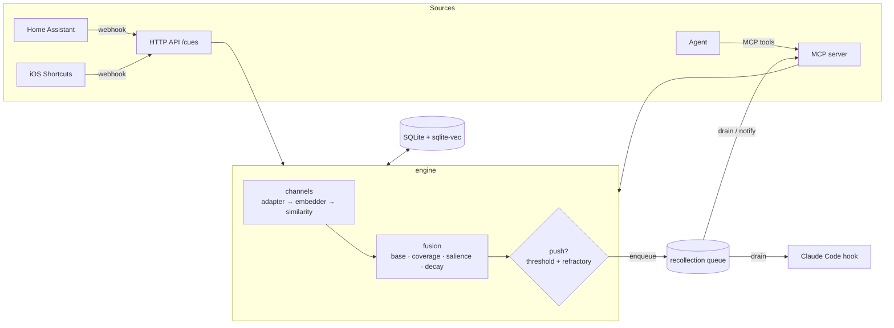

# madeleine

**Involuntary memory for AI agents.** A place, an hour, a sound, a photo or a sensor reading
brings back a related memory on its own, without the agent having to ask. It works the way
the taste of a madeleine brought back Proust's childhood.

<!-- mcp-name: io.github.fabianimv/madeleine -->

[](https://github.com/fabianimv/madeleine/actions/workflows/ci.yml)
· Python 3.11–3.13 · Apache-2.0 · local-first (SQLite) · MCP server + Python library

Most agent memory is *voluntary*: the agent decides to search, writes a query, and gets
results. madeleine adds the other pathway. Every memory is stored with the **sensory
fingerprint** present when it was encoded: where, when, what was said, seen or heard.
Incoming **cues** from webhooks, phones, smart homes and wearables are matched against those
fingerprints all the time. When enough channels line up, the memory is queued as an
**involuntary recollection**, and the agent receives it with its next prompt. This is
*encoding specificity* applied to agents ([concepts](docs/concepts.md)).

## 60-second quickstart

```bash
# 1. See the whole loop, offline (nothing is downloaded, nothing leaves your machine)
uvx madeleine-mcp demo
```

The demo remembers three moments. Then a cue arrives that carries only a place and a time of
day: 30 m from grandmother's house, on a Sunday afternoon. The matching memory surfaces by
itself, is delivered through the MCP tool `pending_recollections`, and does not fire again for
a repeated cue:

```
[madeleine 0.80 via geo+time] Sunday afternoons in grandmother's kitchen: lime-blossom tea and a madeleine (2019-04-14)
  channel similarity geo=0.97, time=1.00; salience x1.16, age decay x0.70
```

```bash
# 2. Give Claude Code the tools
claude mcp add madeleine -- uvx madeleine-mcp serve
```

3. Let involuntary recollections reach every prompt. Add this to `.claude/settings.json`:

```json
{"hooks": {"UserPromptSubmit": [{"hooks": [
  {"type": "command", "command": "uvx madeleine-mcp hook claude-code", "timeout": 10}
]}]}}
```

The hook works even if your client ignores MCP notifications. See
[examples/claude_code](examples/claude_code/README.md) for options such as `--sense-prompt`,
which treats what you type as a cue too.

> **Semantic text needs the `[text]` extra.** The base install is small and offline. Without
> the extra, text is matched *lexically* by a hashing embedder, so "car" and "automobile"
> count as unrelated. For real sentence embeddings (this pulls in PyTorch):
>
> ```bash
> claude mcp add madeleine -- uvx --from 'madeleine-mcp[text]' madeleine-mcp serve
> ```
>
> Images (`[image]`, open_clip) and sound (`[audio]`, LAION CLAP) are opt-in the same way.
> `[all]` installs everything. Models download lazily on first use, never at import.

## How it works



* **Channels** are pluggable senses. Each one has an *adapter* (raw signal → normalised
  observation), an *embedder* (observation → vector) and a *similarity function* (→ [0, 1]).
  Built in: `text`, `time` (hour, weekday and season, all cyclical), `geo` (distance on the
  sphere), `biometric`, `image`, `audio`. `smell` is a documented stub for future e-noses.
* **Recall** combines per-channel similarity over the channels the cue and the memory share,
  adjusts for how much of the cue is covered, boosts salient memories, and decays with age
  down to a floor, so decades-old memories stay reachable. The formula is short and
  explainable; every result says which channels matched
  ([ADR 0001](docs/adr/0001-core-model.md)).
* **Two modes.** *Pull*: the agent asks (`recall`). *Push*: a cue arrives (`sense`, `POST /cues`)
  and memories that clear the threshold are queued without anyone asking.
* **Habituation.** A memory that fired stays quiet for a *refractory period* (default 6 h).
  Walking past the same café all afternoon reminds you of it once.
* **Context alone never fires.** "It's 9 am" matches every memory made at 9 am, so `time`
  (and `biometric`) can strengthen a match but never cause one.

## Sending cues

```bash
madeleine serve --transport http          # REST + MCP (streamable HTTP at /mcp/) on 127.0.0.1:8765
curl -s localhost:8765/cues -H 'content-type: application/json' \
  -d '{"lat": 48.30195, "lon": 1.24650, "signals": [{"channel": "text", "value": "smell of lime-blossom tea"}]}'
```

| Route | Purpose |
|---|---|
| `POST /cues` | Generic cue: `signals`, `at`, `geohash` or `lat`/`lon`, `tags`, `source` |
| `POST /cues/{generic,home_assistant,ios_shortcuts}` | Payloads straight from those tools ([examples](examples/)) |
| `POST /memories`, `POST /recall`, `DELETE /memories/{id}` | Same as the MCP tools |
| `GET /recollections/pending` · `POST /recollections/drain` | Peek / take queued involuntary recollections |

Ready-made integrations: [Home Assistant](examples/home_assistant/README.md) (arriving home,
media starts playing, wearable sensors), [iOS Shortcuts](examples/ios_shortcuts/README.md)
("Arrive at location" personal automation), [curl](examples/curl.sh).

**MCP surface:**
* Tools: `remember`, `recall`, `sense`, `pending_recollections`, `forget`.
* Resource: `recollections://pending`, with `resources/updated` notifications when something
  surfaces. These notifications also work across processes that share the database.

## Privacy and security defaults

* **Local-first.** Everything lives in one SQLite file (`~/.madeleine/madeleine.db`, owner-only
  permissions). There is no telemetry and no cloud.
* **Raw media is not kept.** Image and audio bytes are embedded and then discarded. Only
  vectors and metadata are stored, unless you pass `store_raw=True` (per call or
  `MADELEINE_STORE_RAW=1`).
* **No local file access by default.** Clients must send media bytes. Allowing file paths
  takes `madeleine serve --allow-file-uris`.
* **HTTP binds to 127.0.0.1.** Host and Origin checks block DNS rebinding. Set
  `MADELEINE_API_TOKEN` to require a bearer token. Binding to another interface without a
  token is refused unless you pass `--insecure-no-auth`.
* **`forget` deletes everywhere**: memory, vectors, raw bytes, trigger history and queued
  recollections, with SQLite `secure_delete` on.
* **Recollections are data, not instructions.** The hook wraps them in delimiters and labels
  them as such. Anyone who can write memories can still put text in your agent's context, so
  keep write access to yourself. See [SECURITY.md](SECURITY.md).

## Benchmark (and where it fails)

`madeleine bench` runs an offline synthetic benchmark: 500 memories across 3 cities, 300 cues
with known ground truth, distractors and hard negatives. The numbers below are for the
**offline hash text backend**. Full tables, methodology and blind spots are in
[docs/benchmarks.md](docs/benchmarks.md).

| cue category | pull R@1 | pull R@10 | fires its memory (hit rate) | precision of fires |
|---|---:|---:|---:|---:|
| place + hour | 0.57 | 0.60 | 0.81 | 0.56 |
| text paraphrase only | 0.93 | 1.00 | **0.21** | 1.00 |
| text + place + hour | 0.79 | 1.00 | 0.67 | 0.80 |
| exact same photo / sound | 1.00 | 1.00 | 1.00 | 1.00 |
| slightly altered photo / sound | 0.08 | 0.21 | **0.00** | – |
| memory several years old | 0.63 | 0.93 | 0.40 | 0.86 |
| **negatives** (distractors, time-only, same place + other topic) | | | false-trigger rate **0.00** | |

Latency with 500 memories: `sense` p50 11 ms and p95 23 ms, in pure Python.

**Honest limitations**

* Involuntary recall is tuned to be conservative: no negative cue fired, but only about half
  of positive cues fire their memory.
* With the hash backend, text alone rarely intrudes (21 %) even when it is findable (R@10 = 1).
  Semantic embeddings (`[text]`) should help, but those numbers are not reported here yet.
* Altered media never matches with the hash backend. That needs the CLIP and CLAP extras, and
  their similarity rescaling has only been calibrated on synthetic inputs.
* Place + hour cues saturate (3 fires per cue), and only 56 % of those fall in the strict
  "same place, same hour ±1 h" ground truth.
* The fusion is a hand-designed formula, not a learned one. The data is synthetic English
  text. There is no multi-user auth and no UI. The olfactory channel is a stub.
* Hour-of-day uses each timestamp's own UTC offset. Send local offsets (`+02:00`), or "evening"
  means UTC evening.

## Configuration

| Env var | Default | Meaning |
|---|---|---|
| `MADELEINE_DB` | `~/.madeleine/madeleine.db` | SQLite path (`:memory:` allowed) |
| `MADELEINE_TEXT_BACKEND` | `auto` | `auto` (sentence-transformers if installed), `sentence-transformers`, `hash` |
| `MADELEINE_CHANNELS` | all built-ins | Comma-separated enabled channels |
| `MADELEINE_STORE_RAW` | off | Persist raw media bytes |
| `MADELEINE_ALLOW_LOCAL_FILES` | off | Let media signals reference local files |
| `MADELEINE_API_TOKEN` | unset | Bearer token for the HTTP API (and the hook's `--url` mode) |
| `MADELEINE_ALLOWED_HOSTS` | loopback | Extra Host/Origin names accepted by the HTTP server |

CLI: `madeleine serve | remember | sense | recall | pending | forget | demo | bench | hook claude-code`
(`madeleine --help`).

## As a Python library

```python
from madeleine.config import load_config
from madeleine.core.serde import context_from_fields
from madeleine.engine import create_engine

engine = create_engine(load_config(db_path="memories.db", text_backend="hash"))
now = engine.now()
engine.remember("Ana proposed at the Eiffel Tower",
                context=context_from_fields(now=now, lat=48.8584, lon=2.2945, salience=0.9))
cue = engine.build_cue(context=context_from_fields(now=now, lat=48.8585, lon=2.2946))
for rec in engine.sense(cue):          # involuntary: fires on place (+ time) alone
    print(rec.to_prompt_line())
```

Write your own sense with an `Adapter`, an `Embedder` and a similarity function
([docs/channels.md](docs/channels.md)). ImageBind is deliberately **not** a dependency
because its license is CC-BY-NC, but you can plug it in yourself as an `Embedder`.

## Development

See [CONTRIBUTING.md](CONTRIBUTING.md). Run `uv sync` once, then before every commit:
`uv run pytest`, `uv run ruff check src tests`, `uv run mypy`. The architecture is in
[ARCHITECTURE.md](ARCHITECTURE.md) and the design decisions are in [docs/adr](docs/adr/).

## License

Apache-2.0. See [LICENSE](LICENSE).
